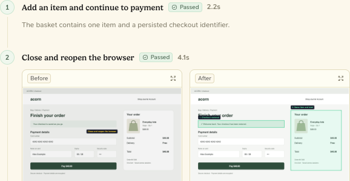
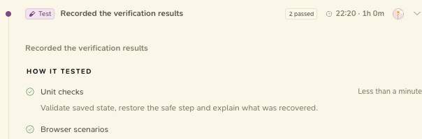

# Timeline

One shared component for ordered steps, recorded events, and activity feeds.
Import `Timeline` and `TimelineItem` from `@blume/sidecar-ui`.

## Choose a presentation

| Variant    | Marker                                      | Use for                                    |
| ---------- | ------------------------------------------- | ------------------------------------------ |
| `steps`    | Small bordered circle with a number or icon | Setup guidance and recorded test steps     |
| `events`   | Quiet dot                                   | Dense phase history with expandable detail |
| `activity` | Unframed custom icon or avatar              | Agent and tool activity                    |

Use `comfortable` density when rows contain explanations or screenshots.
Use `compact` for short event summaries, and `dense` for one-line rows packed close in a
narrow column (the delivery page column's timeline); there a `steps` marker is a 16px circle with
a small bold number. All variants share the rail, alignment,
typography, focus treatment, and motion. The component preserves the order supplied
by its caller; it does not reorder history or infer completion.

## Compose a timeline

```tsx
<Timeline variant="steps" density="comfortable" aria-label="Recorded test steps">
  <TimelineItem marker={1} title="Restore the basket" tone="success">
    <p>The saved basket is visible after restarting.</p>
    <EvidenceGallery />
  </TimelineItem>
</Timeline>
```

Keep a visible status label when color carries status. Marker numbers are decorative;
the ordered list conveys sequence. Give the timeline an accessible name.

### Recorded steps

Numbers, status colors, and evidence share one aligned rail.



### Expandable history

A compact event header opens detail beneath the same content alignment.



## Props

### Timeline

| Prop                              | Values / purpose                                             |
| --------------------------------- | ------------------------------------------------------------ |
| `variant`                         | `steps` (default), `events`, `activity`                      |
| `density`                         | `comfortable` (default), `compact`, `dense`                  |
| `continueBefore`, `continueAfter` | Join adjacent history groups when older entries are revealed |
| Standard list attributes          | Accessible name, ID, and placement classes                   |

### TimelineItem

| Prop                           | Purpose                                                                 |
| ------------------------------ | ----------------------------------------------------------------------- |
| `title`, `metadata`            | Primary row label and supporting information                            |
| `marker`                       | Number, icon, or avatar; ignored visually by the dot variant            |
| `tone`                         | `neutral`, `accent`, `success`, `danger`, `warning`, `info`, `phase`    |
| `children`                     | Description, evidence, details, and action buttons                      |
| `collapsible`                  | Native keyboard-accessible disclosure                                   |
| `defaultExpanded`              | Initial state for an uncontrolled disclosure                            |
| `expanded`, `onExpandedChange` | Controlled disclosure state                                             |
| `highlighted`, `emphasized`    | Temporary row highlight or marker emphasis                              |
| `disclosureRef`                | Native details ref, used by graph-driven phase reveal                   |
| `variant`, `density`           | Optional row-level overrides                                            |
| `last`                         | Explicit rail termination for grouped activity feeds                    |
| `as`                           | `li` by default; `div` for existing feeds that own their list semantics |

`phase` tone uses the existing `data-phase` palette through DeliveryVisuals.
Other tones use the shared opaque badge palette. Do not pass arbitrary CSS colors.

## Expansion and actions

```tsx
<Timeline variant="events" aria-label="Phase history">
  <TimelineItem
    title="Build"
    metadata="8 min"
    collapsible
    expanded={expanded}
    onExpandedChange={setExpanded}
  >
    <p>Updated checkout recovery.</p>
    <Button type="button" variant="outline">
      Inspect changes
    </Button>
  </TimelineItem>
</Timeline>
```

Put action buttons in the body, not inside the disclosure summary. Enter and Space
operate the native summary. Closed content leaves the focus order. Opening and
closing use the shared disclosure motion and respect reduced motion.

## Where it is used

| View                              | Composition                                            |
| --------------------------------- | ------------------------------------------------------ |
| Empty delivery page               | Numbered setup steps                                   |
| Delivery phase history            | `PhaseTimelineItem` adapter, expandable event rows     |
| Verification and test-run detail  | `EvidenceStepTimeline` adapter, numbered status steps  |
| Agent transcript activity         | `ActivityRow` adapter, activity markers and timestamps |
| Setup, usage, and change previews | `StepTimeline` compatibility adapter                   |
| Legacy phase heading              | Shared item with phase icon and metadata               |

Adapters own domain content. `Timeline` owns every rail, marker frame, spacing,
and disclosure recipe. Existing StepTimeline callers remain compatible while
sharing the new rendering; known legacy semantic color tokens map to timeline tones.

Storybook: **Components → Timeline** includes steps, expandable history, controlled
expansion, and activity examples. The history story checks keyboard disclosure.
