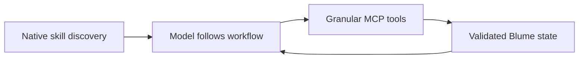
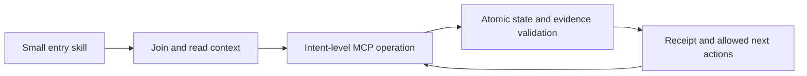
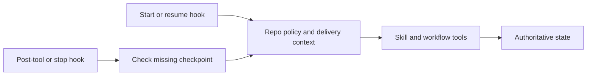

# Plugin architecture: available pieces

Research snapshot: 2026-09-25. Design inventory, not a claim of installed support.
Evaluate combinations against [the expected process](expected-delivery-process.md).

## Scope: Deliveries only

This inventory targets Deliveries in the Blume desktop app (`apps/desktop`; the former
standalone `apps/control-plane` shell is retired) and its Deliveries plugin/MCP. Keep
installations, endpoints, test accounts/projects, and proof records explicitly labeled by
channel.

## What "the plugin" means

"The Blume plugin" is everything the Blume installer puts into a harness, not only
what that harness's plugin or marketplace format can carry. Nothing needs to be
publishable on a harness marketplace. When a harness's plugin format cannot carry a
piece Blume needs (for example, hooks in Codex), the installer, run as a terminal
command or through a prompt to an agent, writes it directly into that harness's own
configuration. It still stays inside the harness home it was given (`CODEX_HOME` or
`CLAUDE_CONFIG_DIR`), and it records what it wrote so `verify` and `uninstall` can
check and undo it.

**Plugin components** are the kinds of things the plugin can install:

- the MCP server and its tools;
- hooks;
- skills;
- rules and server instructions;
- scripts (the bridge);
- docs.

Choose components for what they can do in each harness, not for whether a
marketplace format supports them.

## 1. Getting the agent to use Blume

| Piece | Parameters to vary | Role and limit |
| --- | --- | --- |
| Project instructions / rules | Global vs repository scope; always-loaded vs conditional; length; precedence | Establish default behavior and repo policy. A Markdown rules file is not automatically loaded by every harness. Instruction rules are distinct from executable permission rules. |
| Skills | Trigger description; one workflow vs focused skills; explicit vs inferred activation; progressive reference loading; scripts/examples | Teach when and how to use Blume without permanently loading the entire manual. Discovery is not guaranteed activation. |
| MCP server instructions | Short orientation; first-call guidance; recovery instructions | Orient clients that expose them to the model. Not a universal system prompt or guaranteed conversation-start trigger. |
| Lifecycle hooks | Startup/resume/compaction; prompt submission; before/after tools; stopping; matching; timeout; blocking vs context injection | Restore delivery context or check missing bookkeeping at specific events. Host-specific, needs installation/trust and coverage tests. Avoid an expensive inference call on every event. |
| Explicit entry point | Copyable setup prompt; terminal command; skill/slash command; connect/join prompt | Reliable user-initiated entry and fallback when automatic discovery is unsupported. |

Skills complement server actions with workflow guidance ([OpenAI skills](https://developers.openai.com/plugins/concepts/skills)).
Plugin packaging can combine skills, MCP and hooks, but installed hooks require
trust and executable scripts in the actual environment ([packaging](https://developers.openai.com/plugins/build/plugins)).
Codex documents startup, compaction and tool hooks, with coverage exceptions;
Claude has its own event/output contract. Neither should be treated as a universal
security boundary ([Codex hooks](https://learn.chatgpt.com/docs/hooks),
[Claude hooks](https://code.claude.com/docs/en/hooks)).

## 2. MCP capabilities

| Piece | Parameters to vary | Blume experiment |
| --- | --- | --- |
| Tools | Granularity/count; names/descriptions; typed arguments; required fields; enums; defaults; atomic vs separate operations | Compare granular task/evidence edits with intent-level operations such as begin attempt or submit for review. |
| Tool results | Structured output/schema; short text; resource links; images; actionable errors; state/version receipts | Return authoritative state, missing requirements and legal next actions, rather than an ambiguous success string or an enormous ledger. |
| Tool annotations | Read-only, destructive, idempotent and open-world hints | Help clients present actions. Hints do not enforce authorization or implement idempotency. |
| Resources/templates | URI-addressed context; revision-specific snapshots; task tree; acceptance coverage; pagination | Read delivery context on demand instead of requiring every fact to be another tool. A client decides whether/how resources enter model context. |
| Prompts | Named parameterized workflow templates and entry points | Offer start/join/review workflows. A listed prompt is not automatically injected into every conversation. |
| Argument completion | Completion of prompt/resource-template arguments | Help supported clients select delivery/repo identifiers; not general automatic filling of every tool argument. |
| Change notifications/subscriptions | Resource updates; catalog changes; reconnect handling | Surface new approvals/results. A notification is not a portable instruction to wake an idle agent. Retain a read/poll fallback. |
| Elicitation | Supported forms or URL flows; cancel/decline behavior | Ask for ambiguous delivery selection or configuration. Product approval still needs authenticated, revision-bound server validation. |
| Sampling | Request model work through a supporting client; model preferences; tool use where supported | Optional bounded analysis assistance. Not a guaranteed background model, and not access to the entire client conversation. |
| Roots | Client-provided workspace roots | Assist repository association; roots are not credentials or an enforced filesystem sandbox. |
| Long-running execution | Task extension support; job handles; status/results/cancel; progress | Keep browser tests observable and recoverable. MCP execution tasks are different from Blume's delivery task tree. |
| Transport/authentication | Local stdio bridge vs remote HTTP; capability/version discovery; connection identity; timeouts/retries | Compare setup friction and recovery, preserving scoped authorization and request cancellation. |
| Optional MCP UI | Supported UI extensions and resource presentation | Could assist setup, but does not replace the requested Electron review experience. Treat as client-specific, not baseline MCP behavior. |

Sources: [tools and results](https://modelcontextprotocol.io/specification/2026-07-28/server/tools),
[resources](https://modelcontextprotocol.io/specification/2026-07-28/server/resources),
[prompts, 2025 revision](https://modelcontextprotocol.io/specification/2025-11-25/server/prompts),
[elicitation](https://modelcontextprotocol.io/specification/2026-07-28/client/elicitation),
[sampling](https://modelcontextprotocol.io/specification/2026-07-28/client/sampling),
[protocol overview](https://modelcontextprotocol.io/specification/2026-07-28/basic),
[tasks extension draft](https://tasks.extensions.modelcontextprotocol.io/specification/draft/tasks).

### Version and compatibility gate

Do not mix protocol revisions. The 2026-07-28 specification changes cross-request
state and input requests; list endpoints must not vary per connection. Tasks also
have an extension path distinct from the earlier experimental feature. Therefore,
“state-aware tools” should initially mean stable tools returning valid next actions
and enforcing preconditions, not a catalog secretly changing after each call.
See [the revision changelog](https://modelcontextprotocol.io/specification/2026-07-28/changelog).

For each isolated harness record: executable/version, transport, supported protocol,
advertised capabilities, plugin manifest/version, hooks installed/trusted, and
whether each mechanism actually reaches the model or user. Probe discovery,
invocation, resume/compaction, cancellation and unsupported-feature fallbacks.
Mark each capability documented / advertised / experimentally verified separately.

## 3. Product mechanisms outside MCP

These are equally important pieces; MCP does not supply them automatically:

- **State machine:** phases that follow where the work is (any move is recorded with
  the steps it skipped, never refused), complete review coverage, revision-bound
  human approval as evidence rather than a gate, and explicit blocked states. Separate beginning an operation from
  proving its completion, so Merge and Deploy can describe work in progress.
- **Atomic operations:** bind attempt, revision and related task IDs together;
  publish immutable evidence; validate concurrency and retry keys on the server.
- **Context policy:** ask/default/repository rules, delivery matching, authoritative
  join handles and resumption. Never equate a transport connection with a delivery.
- **External integrations:** GitHub repository/PR/run association, workflow graph,
  deployment status and authenticated Electron decisions. Prefer observed events
  over agent self-reports where an authoritative integration exists.
- **Packaging and recovery:** self-contained installation, connection diagnostics,
  upgrades, revocation and safe restart. Documentation/scripts reduce setup work;
  they do not prove the right instructions were loaded.

## 4. Current implementation evidence

Read in MCP-owner checkout `4047` at this research snapshot:

- `controlMcp.ts` declares tools and server instructions for Deliveries; the hosted
  routes (`controlHostedLedger.ts`) serve them, and `controlPlaneCli.ts` starts the
  plugin's stdio bridge. Do not assume they expose every MCP primitive.
- `plugin.ts` version 0.5.5 generates a discoverable skill, rules, bridge/config
  and documentation; it explicitly says hooks are not installed.
- Separate `protocol.ts` implements resource/template and prompt handlers for
  another user-agent MCP surface. This belongs to a different surface and is reference only, not
  evidence those capabilities reach the current Deliveries client or a decision
  to share its implementation.
- Installed client support for the optional mechanisms above remains to be probed.
  The screenshot's tool count is not an architectural requirement.

## 5. Candidate combinations to test

**A: Instructions plus granular tools.** Baseline: portable and flexible, but many
ordering/attribution decisions remain with the model.

**B: Workflow operations plus progressive context.** Move fragile multi-call
sequences into typed operations; measure whether abstraction hides useful control.

**C: Event-assisted workflow.** Add narrow hooks to B only where they improve
measured discovery/resumption/completeness. Test startup races, denied trust,
latency and repeated-stop loops. Keep hard state invariants in the server.

Hold scenarios/models/permissions constant initially. Change one layer at a time
before comparing full combinations. Use repeated real-agent trials and the expected
process as the behavioral scorecard; report violations, recovery, user effort,
latency and cost. No candidate is selected yet.
