# Blume UI principles

A practical guide to the delivery app. Start with layout, then use the examples
for the component you are working on. How the product treats people's decisions
is in the [product principles](../../../../docs/product-principles.md); how the
code is built is in the
[engineering rules](../../../../docs/architecture-patterns.md#engineering-rules).

> **The common thread:** one clear destination, shared components, and evidence
> close to the decision it supports.

---

## 01 · Layout and navigation

There are **two fundamental page layouts: Columns and Custom**. Both live inside
the same app shell. Cards, tabs, and sub-pages are parts of those layouts, not
additional top-level layout types.

### The hierarchy

| Level | What it owns |
| --- | --- |
| **App shell** | Top bar, app navigation, and the page bar with breadcrumbs and page actions |
| **Page layout** | Columns or Custom, filling the workspace below the page bar |
| **Regions and containers** | Lists, main content, Page Column Cards, and their tabs |
| **Sub-page** | A detail route opened within the workspace, using its own content layout |

**Read the screenshot from outside in:** app navigation at the far left, page bar
across the top, then the page’s list and main content below. The app navigation
is not the list column.

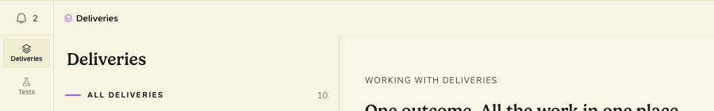

### Columns: list, content, supporting information

Use **ColumnLayout** when selecting an item changes the main content and related
information belongs beside it. Deliveries in List view, Tests, and Agents use this
pattern. Regions are optional; a page does not need all three.

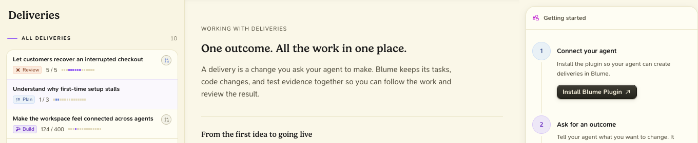

| Region, left to right | Purpose | Example above |
| --- | --- | --- |
| **Primary column** | Choose what to open | Deliveries list |
| **Main content** | Read or work on the selected destination | Delivery explanation; delivery details after selection |
| **Supporting column** | Related information or actions | Getting started; tasks and other supporting views after selection |

The primary column meets the page edges. The supporting column usually contains a
**Page Column Card** with an inset, shared header, and optional tabs or footer.
A Page Column Card is a container inside a region, not another page layout.

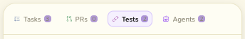

### Column spacing and resize boundaries

Use one **24px content gutter** on each side of the main content. The gap from
content to a supporting Page Column Card must match the gap from the primary
column to content. Do not add a second inset on the card’s content-facing edge.
The card keeps its **12px outer inset** at the top, bottom, and window-facing side.

The resize hit area sits **on the card edge**, never in the middle of the gap:
the left edge of a right-hand card, or the right edge of a left-hand card.
Sub-page overlays retain their own **12px inset** beside an uncovered supporting
card. The 24px main-content gutter rule does not remove this card-to-card gap.

Keep the generous invisible pointer target and keyboard resizing. Sidecar pages
keep their existing full-width layout, without expanded-mode gutters or handles.

### Custom: a workspace with its own arrangement

Use **CustomLayout** when the content needs a different spatial arrangement, such
as the delivery kanban board. It fills the same workspace beneath the page bar,
without imposing list, content, and supporting regions.

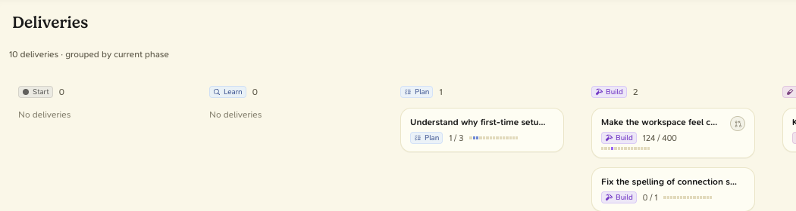

A board lane is part of the board, not a Page Column. Keep horizontal scrolling
for the board. Custom means freedom to arrange the workspace, not different
headers, badges, surfaces, or navigation rules.

### Sub-pages: details within either layout

Both Columns and Custom can open a **SubPageLayout**. In expanded mode it is an
inset card over the regions it covers. Uncovered regions remain usable. A task
may cover only the content; verification or a test run can cover the full workspace.
The covered area uses a flat backdrop.

A sub-page can itself use Columns. In this test-run example, the sub-page header
sits above a scenario list, selected evidence, and a supporting Linked tasks card.

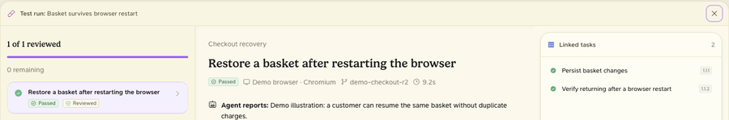

The **sub-page header identifies the route**; a **card header labels a container**
inside it. A screenshot gallery is a dialog, not a sub-page.
See [Back, close, and motion](#07-back-close-and-motion) for return behavior.

### Sidecar: the same hierarchy, one destination at a time

When there is not enough room for useful columns, show **pages and tabs** instead
of stacking the list, selected details, and supporting column vertically.
Use the product container width to decide, not the surrounding browser width.

| Expanded region | Compact presentation |
| --- | --- |
| Primary list and selected content | List page, then detail page with Back |
| Main content and tabbed supporting card | Overview first, then the supporting tabs |
| Main content and an untabbed supporting card | Overview and one named supporting tab |
| Inset sub-page card | Full-page detail with the regular main-content background |

**Tabbed supporting card:** a delivery becomes Overview, Tasks, PRs, Tests, and
Agents. Keep the selected tab when returning.

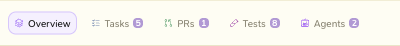

**Untabbed supporting card:** Overview and Linked tasks become two tabs. The Back
action remains separate from those choices.

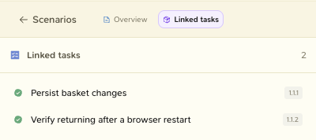

**Full-page details:** use internal padding without an outer card gutter, dark
backdrop, or outer shadow. The content reaches the page edges.

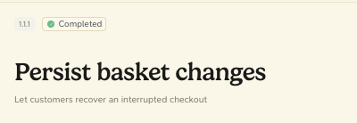

Avoid: carrying the expanded card backdrop into sidecar

This dark strip and inset card are inappropriate in compact mode.

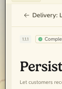

### Resizing preserves the place you are in

- Keep selection, active tabs, filters, and scroll positions.
- Resizing and switching tabs do not add navigation history.
- Expand the native window in width only, on its current display. Preserve height
  and vertical position; use smooth easing and respect reduced motion.
- Only sections of the same destination may stack. Independent regions become
  pages or tabs. Custom boards retain their own horizontal arrangement.

These are interaction requirements. The screenshots above show the resulting
layouts; they do not verify motion or navigation history.

---

## 02 · Headers and typography

**SN Pro regular (400)** is the body default; use heavier SN Pro for emphasis.
**Gelica medium (500)** is for content headings. Keep badge icons in regular strokes.

- Use the shared card header: SN Pro, a small concept/status icon, one-line
  truncated title, consistent height/padding, and a subtle bottom divider.
- Current typography experiment: uppercase container titles and tab labels with
  subtle letter spacing. Content headings and header action labels keep their usual case.
- `CardHeader` owns the title/tabs header surface and optional Back/Close controls.
  `CardHeaderTabsList` uses its tabs mode and retains the shared keyboard/tab behavior.
  A panel has **either a title header or a tab header, never both**.
  `PageColumnCard` enforces that choice through its props. A separately divided
  footer panel can have its own title, such as Revision approval.
- Sub-page layouts supply navigation callbacks and focus refs to `CardHeader`;
  the header does not invent navigation history. Back, Escape, and Close retain
  the existing route and compact-mode behavior.
- Section headers such as **How to use Blume** and **Linked tasks** use SN Pro
  semibold (600) for the full label.
- Entity headers emphasize only the type prefix: **Task:** Persist basket changes.
  Use semibold (600) for “Task:” / “Test run:” and regular (400) for the entity name.
- Tab labels use semibold (600) when selected and regular (400) otherwise.
  Counts and secondary metadata stay regular and visually quieter; header actions
  retain the shared Button styling. Do not use bold (700) as the default header weight.
- Optional counts and actions align at the trailing edge. Task headers use TaskIcon.
- Page Column Cards, regular titled cards, and sub-page cards share this treatment.
  Tabbed headers share its height and divider. Gelica belongs to content/page headings,
  not container labels. Phase identity continues to use DeliveryPhaseBadge.

### Section header

the entire “How to use Blume” label is semibold; the icon stays small.

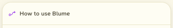

### Entity header

“Task:” is semibold, while the task name stays regular.

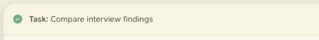

Previous header treatments to replace

### Replace the serif container label with SN Pro

keep the relevant icon and divider.

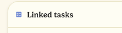

### Add the concept icon and use SN Pro

an explanatory card uses the same header pattern.

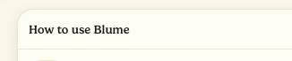

### Tabbed card header

keep the same compact header band and divider. Show a count
only when useful, such as available test evidence.

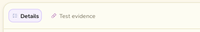

### Panel tabs

the selected label has more weight; counts remain compact and quiet.

---

## 03 · Surfaces and depth

- Reuse semantic surface, border, shadow, typography, and motion tokens. Nested cards
  and floating Page Column Cards use their existing contextual surface/elevation rules.
- Inside an expanded sub-page card, the header and left sidebar cast the same subtle
  shadows into the main content as in the base layout. Reuse the shared shadow
  treatment and intensity; keep the shadows directed into the content area.

### Base layout

the header/sidebar junction shows the direction and quiet intensity
of the shadows. The notification panel is incidental to this crop.

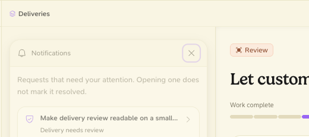

### Sub-page

carry the same treatment into the inner header/sidebar junction.

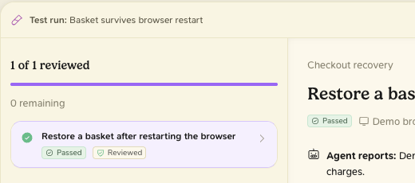

---

## 04 · Status, tasks, and lists

Reuse the same components wherever the same information appears. Color supports
labels and icons; it never carries status on its own.

### Two separate signals

Passed describes the test result; Needs review or Reviewed
describes the human decision. Use a tinted result badge and a linen neutral review
badge, with different icon colors for the review states.

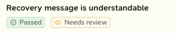

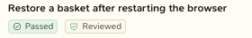

### Task identity

a quiet number badge sits beside the status on a task page.
The number supplements the task icon; it does not replace it in breadcrumbs.

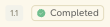

### Task tree

indentation conveys ancestry, number badges align at the trailing
edge, and the phase belongs to the root. A half-circle means in progress, a filled
check means completed, and an open circle means not started.

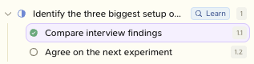

### Breadcrumb identity

use the task status icon with its name, rather than the
number badge. Truncate long labels without displacing the icon.

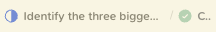

### Phase identity

use the shared phase badge, including its icon, color, border,
and label; a phase card does not invent its own treatment.

In a delivery's page header the phase badge is also a menu button
(`DeliveryPhaseBadge` with `menu`, rendered by the shared `EntityMenuButton`): it keeps
the badge's icon, color, border and label, adds a small caret, and opens the eight
phases with the current one checked. Choosing another sets the delivery there
(`delivery_phase_set`), forward or back, through the same action path and error
display as the page's other person operations. The visit it opens says "Moved here
by you" with the steps the move skipped. Badges elsewhere (rows, tiles, timelines)
stay plain labels.

The official phase palette comes from [Delivery lifecycle PR #539](https://github.com/blumepage/sidecar-prototype/pull/539).
`theme.css` owns the exact `--phase-*` values; graph lines, icons, progress segments,
and timeline dots use these colors. Badge text and opaque surfaces use matching
light/dark ramps for readability. Phase colors remain independent of the selected flower theme.

| Phase | Color | Canonical OKLCH |
| --- | --- | --- |
| Start | Slate | `68% 0.025 255` |
| Learn | Blue | `60% 0.15 250` |
| Plan | Violet | `58% 0.17 285` |
| Build | Magenta | `58% 0.18 320` |
| Test | Rose | `60% 0.2 355` |
| Review | Coral | `63% 0.19 30` |
| Ready | Amber | `72% 0.15 65` |
| Merge | Green | `62% 0.15 135` |
| Deploy | Teal | `59% 0.15 165` |
| Live | Cyan-blue | `50% 0.14 225` |

### List and board parity

the same delivery carries the same title, phase badge,
completion count, and progress treatment in both representations.

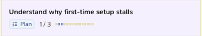

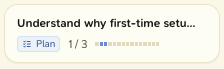

### Progress

small gaps and rounded ends distinguish the segments. Keep the label
and completion count together above the bar.

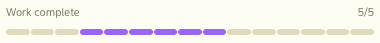

---

## 05 · Empty states

### Give the main area a purpose

explain what a delivery does and show the next
useful action. The Gelica content heading and regular SN Pro body establish hierarchy
without giving every line its own section heading.

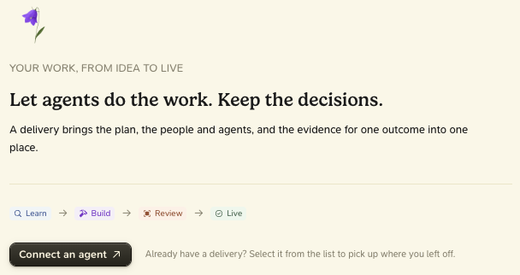

### Keep supporting guidance in its column

the right card explains how to use
Blume, with a shared semibold SN Pro header and readable steps. In sidecar, supporting
content follows the same tab-conversion rules as other right columns.

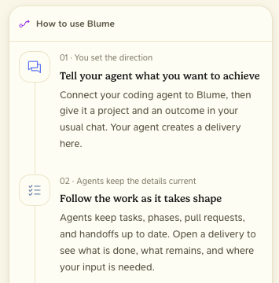

---

## 06 · Evidence and approval

Use the shared [Timeline component](components/timeline.md) for numbered test steps,
phase history, onboarding, and activity. Its variants share markers, rails, spacing,
and keyboard-accessible expansion.

### Evidence belongs to a step

number and describe the step, then show its Before
and After captures side by side. Keep each image inside a restrained frame without
rounding the screenshot itself. The crop illustrates grouping, not a real test result.

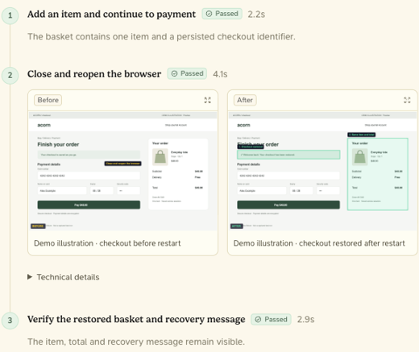

### Scenario actions

navigation, a compact position counter, and the review decision
share the bottom bar. Reviewing evidence is separate from approving the revision.

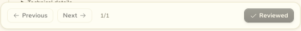

### Reviewed scenario

the filled check and review badge communicate the human
review state independently of the test result.

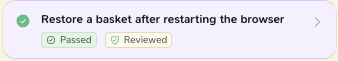

### Revision approval has its own panel

separate header, requirements, and final
action. The supporting linked-task header must not appear to label this decision.
The example shows an already-approved revision; approval is separate from merge/deploy.

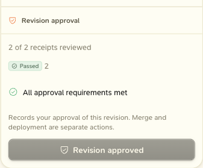

### Gallery navigation

keep Previous/Next and the capture position visible. Arrow
keys should move between captures; Escape should dismiss the gallery before the page.
These crops show the controls at readable scale rather than shrinking the whole dialog.

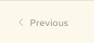

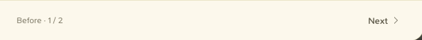

### Screenshot tools

keep guidance, sizing, and close controls together. Annotations
belong on the evidence image and should explain what to inspect.

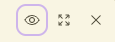

---

## 07 · Back, close, and motion

> **Review pending:** the expanded behavior is approved. Sidecar Back, Escape, and close still need interaction review.

- Preserve the existing expanded-mode behavior; the user has approved it.
- Back returns to the actual preceding destination and names it concisely, without
  a “Back to” prefix. Truncate long destination names. Inferred breadcrumb ancestors
  are not necessarily navigation history.
- In expanded mode, X closes the current sub-page card to its underlying page.
  Escape follows the existing history-aware behavior; dialogs/popovers consume it first.
- In sidecar/mobile, render details as pages, not floating cards. Use one clear Back
  action. Avoid duplicate Back bars or showing both Back and X for the same operation.
- In sidecar, Back and Escape return from supporting details to the scenario, then
  to the scenario list, then to the originating page. Nested task/test pages retrace
  visited pages. Tabs retain their selection when returning; changing a tab does not
  add history. Dialogs consume Escape first. Resize never changes this history.
- Sidecar Escape/X/Back behavior is not yet approved: finish and review it before
  writing the full documentation.

### Expanded close

X belongs at the trailing edge of the sub-page header and returns
to the underlying page. This crop shows its placement, not an Escape history test.

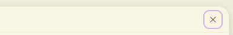

### Sidecar return

a concise destination label accompanies the Back arrow. It names
the preceding destination; it is not a second title or a duplicate close action.

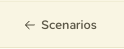

### Disclosures

a quiet chevron and label reveal supporting detail. Animate opening
and closing with the same motion treatment; keep the trigger keyboard-accessible.

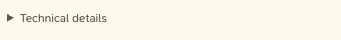

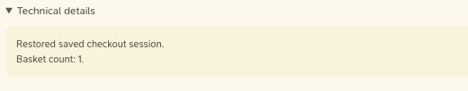

The closed/open pair illustrates disclosure structure. Timing, easing, reduced motion,
native window resizing, and actual Back/Escape history still need interaction review;
static screenshots are not acceptance evidence for those behaviors.

---

## 08 · Before you ship

- Reuse shared primitives and run design lint.
- Check expanded and sidecar layouts for overflow and readable spacing.
- Follow Back and Escape through nested pages and dialogs.
- Check transitions, keyboard focus, and reduced motion.
- Test native window resizing in Electron.

Static screenshots illustrate appearance. They do not prove interaction behavior.

About these examples and their review status

This is the concise review draft for the delivery control-plane app. Full component
documentation follows design approval. Screenshots illustrate only the pattern
named in their caption, not every detail shown.

Captured 24 September 2026. Demo data and relative times are illustrative.
[Capture notes](../../design-assets/ui-principles/capture-notes.md) record sources and limitations.
Images live beside this Markdown file so the guide remains portable.

